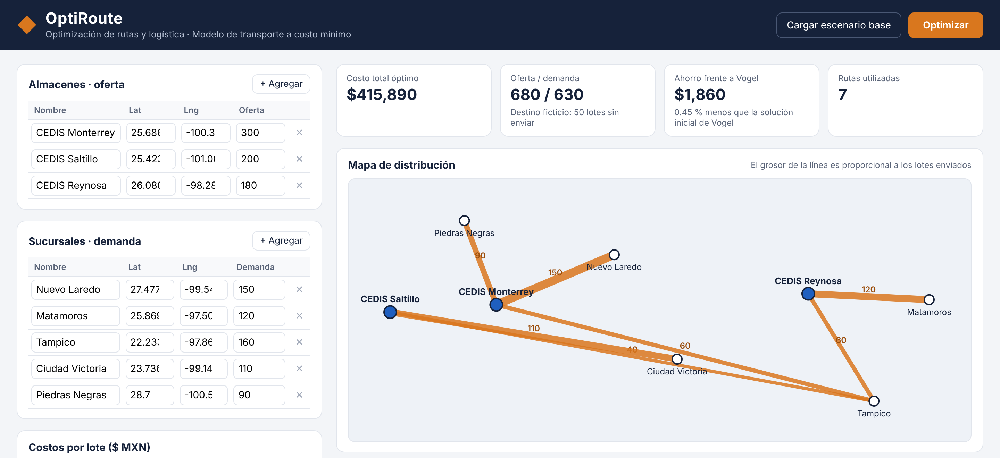

# OptiRoute · Sistema web de optimización de rutas y logística

Proyecto Integrador de **Investigación de Operaciones** (Unidad 6), opción A.
Autor: Cesar Rodrigo Solis Tome · Licenciatura en Tecnologías de la Información · UAT, FCACS Nuevo Laredo.

OptiRoute resuelve el **modelo de transporte a costo mínimo** de una distribuidora simulada de equipo de cómputo y redes, *NorTec Distribución*. La empresa tiene 3 centros de distribución y 5 sucursales en el noreste de México. Recibe la oferta de cada almacén, la demanda de cada sucursal y el costo por lote de cada ruta. Con eso:

- balancea automáticamente el problema con un destino u origen ficticio;
- calcula el plan de envíos óptimo con **SciPy (`linprog`, método HiGHS)**;
- muestra las rutas en un mapa interactivo (Leaflet + OpenStreetMap);
- genera el **análisis de sensibilidad**: precios sombra de almacenes y sucursales, costos reducidos y rango de cada costo;
- compara el óptimo con los métodos vistos en clase: esquina noreste, costo mínimo y Vogel;
- redacta una interpretación gerencial automática y exporta el plan a CSV.



## Modelo matemático

Variables de decisión: `x_ij` = lotes enviados del almacén *i* a la sucursal *j* (i = 1..3, j = 1..5).

```
Min Z = Σ_i Σ_j c_ij · x_ij                    ($ MXN por mes)

s.a.  Σ_j x_ij ≤ s_i      ∀ i   (capacidad de cada almacén, lotes)
      Σ_i x_ij = d_j      ∀ j   (demanda de cada sucursal, lotes)
      x_ij ≥ 0
```

Como la oferta (680) es mayor que la demanda (630), la holgura de las restricciones de oferta equivale al **destino ficticio** de costo cero. El costo de cada ruta se estima como `c_ij = 40 + 1.8 × (distancia en línea recta × 1.25)`.

## Estructura del repositorio

```
optiroute/
├── app.py                  # Servidor Flask y API REST
├── engine/modelo.py        # Motor cuantitativo: LP, sensibilidad y métodos iniciales
├── data/escenario_base.json
├── templates/index.html    # Interfaz
├── static/app.js           # Lógica de la interfaz, mapa y reportes
├── static/style.css
├── tests/test_modelo.py    # Pruebas automáticas (pytest)
└── requirements.txt
```

## Instalación y uso

Requiere Python 3.10 o superior.

```bash
python -m venv .venv
# Windows: .venv\Scripts\activate    ·    macOS/Linux: source .venv/bin/activate
pip install -r requirements.txt
python app.py
```

Abrir <http://127.0.0.1:5000>. El escenario base se carga solo. Cualquier dato (oferta, demanda, coordenadas o costos) se puede editar, y se vuelve a resolver con **Optimizar**. El mapa necesita conexión a internet. Sin conexión se muestra un esquema de rutas equivalente.

Para correr las pruebas:

```bash
python -m pytest -q
```

## API

| Método | Ruta | Descripción |
|---|---|---|
| GET | `/api/escenario` | Escenario base |
| POST | `/api/costos` | Matriz de costos por distancia a partir de coordenadas |
| POST | `/api/resolver` | Plan óptimo, precios sombra, costos reducidos, rangos y comparación de métodos |

## Resultados del escenario base

| Método | Costo total |
|---|---|
| Esquina noreste | $484,570 |
| Costo mínimo | $421,410 |
| Vogel | $417,750 |
| **Óptimo (HiGHS)** | **$415,890** |
